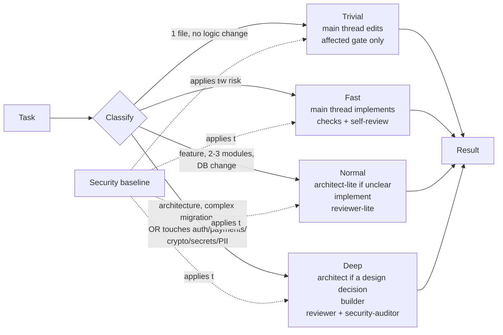

# Claude Code project template

[](https://github.com/JohnSnow46/claude-code-project-template/actions/workflows/checks.yml)

A lightweight Claude Code setup for small and medium projects — web apps, APIs, SaaS,
internal tools, CLIs, prototypes headed for production. Any language, any framework.

Three ideas:

- **Speed first.** Most tasks are small, so the default path is the main Claude thread
  doing the work directly — no subagents, no plans, no reports. A one-line typo fix
  doesn't even run the full gate suite.
- **Security by default.** A short security baseline applies to every change, a hook
  blocks dangerous git operations and secret commits, and security-sensitive work is
  always escalated — however small the diff.
- **Right-sized.** Bigger or riskier changes get more scrutiny; small ones stay small.

## Install

```bash
cp -r CLAUDE.md THIRD_PARTY_NOTICES.md docs .claude scripts .github .gitattributes .pre-commit-config.yaml /path/to/your-project/
cd /path/to/your-project
bash scripts/quality-gates.sh --detect      # suggested gates for your stack → .claude/quality-gates.conf
python3 scripts/configure.py profile solo   # or team / high-security
bash scripts/install-git-hooks.sh           # secret scan before every commit (yours too)
```

Then fill in the `[placeholders]` in `CLAUDE.md` (project, commands, conventions) and add
your build/test commands to `permissions.allow` in `.claude/settings.json`. Install
[gitleaks](https://github.com/gitleaks/gitleaks#installing) locally; the `team` and
`high-security` profiles require it.
[USAGE.md](USAGE.md) walks through it step by step. Already have a `CLAUDE.md` or a CI
workflow? Merge by hand.

Starting a .NET project? The `dotnet` branch has `CLAUDE.md` pre-filled for .NET (it may
lag behind `master`).

## What's in the box

```
CLAUDE.md                     project instructions: mode table, baseline, gates, result block
USAGE.md                      step-by-step setup
docs/                         security reference, ADR index + example ADR, docs conventions, v2 audit
.claude/
  settings.json               permissions (deny secrets at any depth, ask on push/destructive git) + hooks
  profiles/                   solo / team / high-security overlays for settings.json
  quality-gates.conf          test / lint / typecheck / build commands for your stack
  hooks/guard-bash.sh         denies unsafe git + secret reads via Bash, asks on destructive git
  hooks/guard-files.sh        denies Read/Edit/Write/Grep on secret files
  hooks/scan-secrets.sh       built-in patterns + gitleaks when installed
  agents/                     9 subagents (2 optional)
  skills/                     7 skills (workflow: per-mode steps, loops, docs procedure)
scripts/
  quality-gates.sh            runs the gates in order; --detect suggests a config
  configure.py                switch profile, set agent models + fallback chain
  validate_template.py        config validator (Python stdlib only)
  check-deps.sh               dependency audit, auto-detects your stack
  git-hooks/pre-commit        secret scan for every commit; install-git-hooks.sh installs it
  tests/                      hook, settings, profile, gate and validator tests
.pre-commit-config.yaml       same checks for the pre-commit framework (optional)
.github/workflows/checks.yml  CI: quality gates on Linux/macOS/Windows + full-history gitleaks
```

## How it works



The main thread picks the mode itself from the table in `CLAUDE.md` and, above Trivial,
follows the `workflow` skill — no classifier
agent, no question to you. When unsure it picks the lower mode and escalates if a real
signal appears.

| Mode | When | What runs |
|---|---|---|
| **Trivial** (default) | 1 file, a few lines, no logic change: typo, copy, config value, rename within one file, comment/doc edit | Main thread only: edit → the one gate the change can affect (none for prose) |
| **Fast** (next step up) | UI, styling, small fixes, simple CRUD, docs, config | Main thread only, acting as builder: implement → quality gates → self-review against the baseline |
| **Normal** | New feature with logic, 2-3 modules, additive DB change, integration | `architect-lite` *only if* contracts/design are unclear → implement (main thread, or `builder` for large work) → quality gates → `reviewer-lite` |
| **Deep** | Architecture/boundary change, complex migration, **anything directly touching auth, permissions, payments, crypto, secrets or sensitive personal data** | `architect` *only if* there's a design decision (else a 5-line threat note) → `builder` → quality gates → `reviewer` ∥ `security-auditor` |

**Optional agents**, Normal/Deep only and only when their signal exists: `test-engineer`
(user-facing flow or integration boundary changed, project has E2E/integration tests) and
`performance-analyst` (a concrete slowdown, budget or hot-path change). Never in Trivial or Fast.

**Quality gates:** `bash scripts/quality-gates.sh` runs test → lint → typecheck →
build → security from `.claude/quality-gates.conf`. Every mode runs it (Trivial: only the gate the
edit can affect) before reporting `completed` and quotes the `RESULT:` line. Under `team`/`high-security` an unconfigured
gate fails; `none` declares it not applicable.

**Guardrails on the pipeline itself:**

- Every subagent ends with the same result block: `status` (`completed` / `blocked` /
  `needs_escalation`), `summary`, `files_changed`, `validation`, `risks`,
  `unresolved_issues`.
- At most **2** review → fix cycles. Still failing → `blocked`, reported to you with the
  open findings. No silent "done".
- `needs_escalation` moves up a mode and continues with the work already done.
- No success claim without a verification command that actually ran.

**Stage-end and pre-deploy:** if you work in stages, a stage with 2+ tasks closes with a
full `reviewer` pass (plus `security-auditor` if it touched auth/sensitive data).
`security-auditor` runs once before every production deploy.

### Example

> "Add a 'favorites' list to the customer panel" → **Normal**. The main thread checks the
> existing customer API; contracts are clear, so no `architect-lite`. It adds the
> endpoint, migration and UI, runs the tests, then `reviewer-lite` checks the diff:
> authz on the new endpoint, input validation, a test exists → `completed`. You run
> `/commit`.
>
> "Let admins reset another user's password" → a few lines of code, but it touches
> authorization and credentials → **Deep**. No new architecture, so the main thread writes
> a short threat note instead of calling `architect` (who can call it? is the old session
> invalidated? is it logged?). `builder` implements, `reviewer` and `security-auditor`
> run in parallel; `security-auditor` finds sessions survive the reset → `blocked` →
> `builder` fixes → re-audit → `completed`.

## Security

| Layer | What it does | Where |
|---|---|---|
| Baseline | 8 rules every change follows (no secrets in code, validate input, parameterized queries, server-side authz, no sensitive data in logs/errors, no insecure defaults, never disable a control to pass, minimal deps) | `CLAUDE.md` |
| Escalation | Direct contact with auth/permissions/payments/crypto/secrets/PII → Deep + `security-auditor` | `CLAUDE.md`, `workflow` skill |
| Review | `reviewer-lite` checks the baseline on Normal changes; `security-auditor` does threat-focused audits | `.claude/agents/` |
| Bash hook | **Denies** bulk `git add`, `commit -a`, hook bypass (`--no-verify`, `core.hooksPath`), force/mirror push, reading secret files (`cat`/`base64`/`python -c` … `.env`), and any commit whose staged diff fails the secret scan. **Asks** on `reset --hard`, `clean -f`, `branch -D`, remote delete, history rewrites; denies those too in auto/bypass mode, where nobody would see the prompt. Same result however git is invoked (`-c`, `-C`, `sh -c`, chains, quotes) | `.claude/hooks/guard-bash.sh` |
| File hook | Denies Read/Edit/Write/Grep on `.env*` (not `.env.example`), keys, SSH/cloud credentials. Second layer behind the deny rules | `.claude/hooks/guard-files.sh` |
| Permissions | Secret files unreadable/uneditable at any depth; `git push`/`reset --hard`/`clean` ask; bulk add/force push denied; hooks fail closed (`onFailure: block`) | `.claude/settings.json` |
| Secret scan | Built-in high-confidence patterns as a floor + **gitleaks** whenever installed (required in `team`/`high-security` and CI). Runs on Claude's commits, everyone's commits (git pre-commit hook), and in CI over the full history | `scan-secrets.sh`, `scripts/git-hooks/`, CI |
| Profiles | `solo` / `team` / `high-security` tighten all of the above | `.claude/profiles/` |
| CI | Quality gates on Linux, macOS and Windows; pinned, checksum-verified gitleaks over full history | `.github/workflows/checks.yml` |

Limits, honestly: the hooks match command **text**, so a command assembled at runtime
(`$VAR`, `eval`, a script file) can get past them. For real isolation use the sandbox
(`high-security`) or a container, and don't keep production secrets in the working tree.
The hooks and checks are deterministic; whether Claude follows `CLAUDE.md` is not.
Everything here, layer by layer, with tested cases and limits: [docs/security.md](docs/security.md).

## Agents

| Agent | Used in | Job | Model |
|---|---|---|---|
| `architect-lite` | Normal, when unclear | Short plan with verified contracts of existing code | Sonnet |
| `architect` | Deep, real design decision | Design, threat analysis, ADR | Opus |
| `builder` | Deep; large Normal work; fixes | Implements code + tests | Sonnet |
| `reviewer-lite` | Normal | Blocking bugs, baseline, build/tests | Sonnet |
| `reviewer` | Deep; stage-end | Full review (architecture, tests, data, contracts) | Opus |
| `security-auditor` | Deep security work; stage-end; pre-deploy | Threat-focused audit, read-only | Opus |
| `debugger` | Any time something's broken | Root-cause analysis | Sonnet |
| `test-engineer` | Optional: Normal/Deep with a changed user flow / integration boundary | E2E + integration tests, never production code | Sonnet |
| `performance-analyst` | Optional: a concrete performance signal | Measures, finds the cause, proposes fixes (read-only) | Sonnet |

Reviewers, the auditor and the analyst are read-only (enforced by the validator).

**Models without assumptions.** Agents use aliases, never pinned IDs. Two tiers: strong
(`architect`, `reviewer`, `security-auditor`) and standard (the rest).

```bash
python3 scripts/configure.py models --strong sonnet          # no Opus on your plan
python3 scripts/configure.py models --all inherit            # every agent uses your session's model
python3 scripts/configure.py models --fallback sonnet,haiku  # fallbackModel chain when the primary is unavailable
python3 scripts/configure.py show
```

## Profiles

```bash
python3 scripts/configure.py profile team   # solo (default) | team | high-security
```

| | solo | team | high-security |
|---|---|---|---|
| Guards, secret denies, ask on destructive git | ✓ | ✓ | ✓ (asks become denies) |
| gitleaks required, unconfigured gate fails | | ✓ | ✓ |
| No direct push to main/master; `.github/`, `.claude/` edits ask | | ✓ | ✓ |
| Dependency audit required, no WebFetch/curl/wget, bypass mode off, Bash sandbox | | | ✓ |

A profile is an overlay. `.claude/profile-state.json` records exactly what it changed,
so switching undoes only that: your own rules survive, even ones identical to a profile
rule. The validator fails if `settings.json` drifts from its profile.

## Skills

| Skill | How it runs | Use for |
|---|---|---|
| `/feature <task>` | You type it | Runs the workflow with an explicit mode line, loop cap and result block |
| `/commit` | You type it | Inspect → stage by name → review staged diff → commit. No push, no `--no-verify` |
| `workflow` | Claude loads it | Per-mode steps, review loops, stage-end, ADR/docs procedure — kept out of `CLAUDE.md` so it only loads when needed |
| `verification-before-completion` | Claude loads it | Evidence before "done"/"passes" |
| `writing-skills` | Claude loads it | Rules for writing agents/skills |
| `writing-tests`, `project-conventions` | You, until filled in | Placeholders — fill in, then remove `disable-model-invocation` |

You don't need `/feature` — asking normally uses the same rules. `/feature` just makes
each step visible.

## Checks

```bash
bash scripts/quality-gates.sh                    # all of the below, in order, with a summary
python scripts/validate_template.py              # config consistency (stdlib only)
python -m unittest discover -s scripts/tests     # validator, settings wiring, profiles, gates
bash scripts/tests/test_hooks.sh                 # ~160 allow/ask/deny cases incl. audited bypasses
bash .claude/hooks/scan-secrets.sh --all         # secret scan (built-in + gitleaks if installed)
bash scripts/check-deps.sh                       # dependency audit for your stack
```

The validator checks frontmatter, broken links, references to agents/skills/commands
that don't exist, size budgets (descriptions, skill bodies, `CLAUDE.md` ≤ 130 lines),
read-only reviewers, the permission rules, that every hook script exists, covers its
tools and fails closed, that `settings.json` matches its profile, the gate config, that
CI runs the gates and gitleaks, and that the workflow rules (Fast has no subagents, the
2-cycle cap, the security override, quality gates) are still present.

The tests check **behavior**. `test_settings.py` runs every hook through the exact
command string in `settings.json`. `test_hooks.sh` feeds the guards the same JSON Claude
Code sends and asserts allow/ask/deny. Negative tests break one rule each and assert the
validator catches it.

## Customizing

- **Trim** — no deep work? Delete `architect`, `reviewer`, and their mentions in
  `CLAUDE.md`, `workflow/SKILL.md` and `feature/SKILL.md`; the validator flags anything you missed. No ADRs?
  Delete `docs/` and the ADR lines in `CLAUDE.md`.
- **Tune the mode table** — if Fast tasks keep getting agents, or risky ones stay Fast,
  edit the signals in `CLAUDE.md`. The security override is the one line not to weaken.
- **Add an agent/skill** — read `writing-skills` first, end agents with the result block,
  run the validator.
- **Project checks** — put your test/lint/typecheck/build commands in
  `.claude/quality-gates.conf` (`--detect` suggests them for Node, Python, Go, Rust,
  .NET) and add your toolchain setup step to `.github/workflows/checks.yml`. CI and Claude
  then run the same gates.

`docs/audit-v2.md` lists what changed in v2 and why.

## Attribution

| Source | License | What was taken |
|---|---|---|
| A real portfolio project | — (own work) | The three-mode pipeline, agent roles, ADR index + log split, context-reading discipline |
| [mattpocock/skills](https://github.com/mattpocock/skills) | MIT | Model-invoked vs. user-invoked as a design axis |
| [obra/superpowers](https://github.com/obra/superpowers) | MIT | `writing-skills` and `verification-before-completion`, condensed and rewritten |
| [EveryInc/compound-engineering-plugin](https://github.com/EveryInc/compound-engineering-plugin) | MIT | Cross-check of agent/skill frontmatter conventions |
| Anthropic — [Skills](https://code.claude.com/docs/en/skills), [Sub-agents](https://code.claude.com/docs/en/sub-agents), [Hooks](https://code.claude.com/docs/en/hooks), [Best practices](https://code.claude.com/docs/en/best-practices) | — (documentation) | Frontmatter, hooks and permissions conventions |

Copyright notices for adapted MIT content: [THIRD_PARTY_NOTICES.md](THIRD_PARTY_NOTICES.md).

MIT licensed — see [LICENSE](LICENSE).
