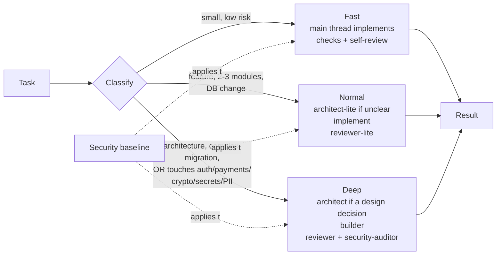

# Claude Code project template

[](https://github.com/JohnSnow46/claude-code-project-template/actions/workflows/checks.yml)

A lightweight Claude Code setup for small and medium projects — web apps, APIs, SaaS,
internal tools, CLIs, prototypes headed for production. Any language, any framework.

Three ideas:

- **Speed first.** Most tasks are small, so the default path is the main Claude thread
  doing the work directly — no subagents, no plans, no reports.
- **Security by default.** A short security baseline applies to every change, a hook
  blocks dangerous git operations and secret commits, and security-sensitive work is
  always escalated — however small the diff.
- **Right-sized.** Bigger or riskier changes get more scrutiny; small ones stay small.

## Install

```bash
cp -r CLAUDE.md docs .claude scripts .github /path/to/your-project/
```

Then fill in the `[placeholders]` in `CLAUDE.md` (project, commands, conventions) and add
your build/test commands to `permissions.allow` in `.claude/settings.json`.
[USAGE.md](USAGE.md) walks through it step by step. Already have a `CLAUDE.md` or a CI
workflow? Merge by hand.

Starting a .NET project? The `dotnet` branch has `CLAUDE.md` pre-filled for .NET (it may
lag behind `master`).

## What's in the box

```
CLAUDE.md                     project instructions: modes, security baseline, result contract
USAGE.md                      step-by-step setup
docs/                         ADR index + example ADR, docs conventions, v2 audit
.claude/
  settings.json               permissions (ask before push, deny bulk add/.env reads) + hook
  hooks/guard-bash.sh         blocks unsafe git commands, secret-scans every commit
  hooks/scan-secrets.sh       stack-agnostic secret scanner (bash + git + grep)
  agents/                     7 subagents
  skills/                     6 skills
scripts/
  validate_template.py        config validator (Python stdlib only)
  check-deps.sh               optional dependency audit, auto-detects your stack
  tests/                      tests for the validator and the hook
.github/workflows/checks.yml  CI: secret scan, validation, tests, optional dep audit
```

## How it works



The main thread picks the mode itself from the table in `CLAUDE.md` — no classifier
agent, no question to you. When unsure it picks the lower mode and escalates if a real
signal appears.

| Mode | When | What runs |
|---|---|---|
| **Fast** (default) | UI, styling, small fixes, simple CRUD, docs, config | Main thread only: implement → run relevant checks → self-review against the baseline |
| **Normal** | New feature with logic, 2-3 modules, additive DB change, integration | `architect-lite` *only if* contracts/design are unclear → implement (main thread, or `builder` for large work) → `reviewer-lite` |
| **Deep** | Architecture/boundary change, complex migration, **anything directly touching auth, permissions, payments, crypto, secrets or sensitive personal data** | `architect` *only if* there's a design decision (else a 5-line threat note) → `builder` → `reviewer` ∥ `security-auditor` |

**Guardrails on the pipeline itself:**

- Every subagent ends with the same result block: `status` (`completed` / `blocked` /
  `needs_escalation`), `summary`, `files_changed`, `validation`, `risks`,
  `unresolved_issues`.
- At most **2** review → fix cycles. Still failing → `blocked`, reported to you with the
  open findings. No silent "done".
- `needs_escalation` moves up a mode and continues with the work already done.
- No success claim without a verification command that actually ran.

**Stage-end and pre-deploy:** if you work in stages, a stage with 2+ tasks closes with a
full `reviewer` pass (plus `security-auditor` if it touched auth/sensitive data).
`security-auditor` runs once before every production deploy.

### Example

> "Add a 'favorites' list to the customer panel" → **Normal**. The main thread checks the
> existing customer API; contracts are clear, so no `architect-lite`. It adds the
> endpoint, migration and UI, runs the tests, then `reviewer-lite` checks the diff:
> authz on the new endpoint, input validation, a test exists → `completed`. You run
> `/commit`.
>
> "Let admins reset another user's password" → a few lines of code, but it touches
> authorization and credentials → **Deep**. No new architecture, so the main thread writes
> a short threat note instead of calling `architect` (who can call it? is the old session
> invalidated? is it logged?). `builder` implements, `reviewer` and `security-auditor`
> run in parallel; `security-auditor` finds sessions survive the reset → `blocked` →
> `builder` fixes → re-audit → `completed`.

## Security

| Layer | What it does | Where |
|---|---|---|
| Baseline | 8 rules every change follows (no secrets in code, validate input, parameterized queries, server-side authz, no sensitive data in logs/errors, no insecure defaults, never disable a control to pass, minimal deps) | `CLAUDE.md` |
| Escalation | Direct contact with auth/permissions/payments/crypto/secrets/PII → Deep + `security-auditor` | `CLAUDE.md` |
| Review | `reviewer-lite` checks the baseline on Normal changes; `security-auditor` does threat-focused audits | `.claude/agents/` |
| Git hook | Blocks bulk `git add`, `commit -a`, `--no-verify`, force push — anywhere in a command — and scans the staged diff for secrets before every `git commit` | `.claude/hooks/guard-bash.sh` |
| Permissions | `.env`/key files can't be `Read`; `git push` always asks; bulk add/force push denied | `.claude/settings.json` |
| CI | Secret scan of tracked files, config validation, optional dependency audit | `.github/workflows/checks.yml` |

Limits, honestly: the `Read` deny rules don't stop a Bash command from printing `.env`;
the secret scanner only knows high-confidence patterns (cloud/API keys, private keys,
passwords in URLs) — add [gitleaks](https://github.com/gitleaks/gitleaks) if you need
more. The hook and the checks are deterministic; whether Claude follows the instructions
in `CLAUDE.md` is not.

## Agents

| Agent | Used in | Job | Model |
|---|---|---|---|
| `architect-lite` | Normal, when unclear | Short plan with verified contracts of existing code | Sonnet |
| `architect` | Deep, real design decision | Design, threat analysis, ADR | Opus |
| `builder` | Deep; large Normal work; fixes | Implements code + tests | Sonnet |
| `reviewer-lite` | Normal | Blocking bugs, baseline, build/tests | Sonnet |
| `reviewer` | Deep; stage-end | Full review (architecture, tests, data, contracts) | Opus |
| `security-auditor` | Deep security work; stage-end; pre-deploy | Threat-focused audit, read-only | Opus |
| `debugger` | Any time something's broken | Root-cause analysis | Sonnet |

Reviewers and the auditor are read-only (enforced by the validator). No Opus on your
plan? Change `model: opus` to `sonnet` in those three files.

## Skills

| Skill | How it runs | Use for |
|---|---|---|
| `/feature <task>` | You type it | Runs the workflow with an explicit mode line, loop cap and result block |
| `/commit` | You type it | Inspect → stage by name → review staged diff → commit. No push, no `--no-verify` |
| `verification-before-completion` | Claude loads it | Evidence before "done"/"passes" |
| `writing-skills` | Claude loads it | Rules for writing agents/skills |
| `writing-tests`, `project-conventions` | You, until filled in | Placeholders — fill in, then remove `disable-model-invocation` |

You don't need `/feature` — asking normally uses the same rules. `/feature` just makes
each step visible.

## Checks

```bash
python scripts/validate_template.py              # config consistency (stdlib only)
python -m unittest discover -s scripts/tests     # validator tests
bash scripts/tests/test_hooks.sh                 # git guard + secret scanner tests
bash .claude/hooks/scan-secrets.sh --all         # secret scan of tracked files
bash scripts/check-deps.sh                       # optional: dependency audit for your stack
```

The validator checks frontmatter, broken links, references to agents/skills/commands
that don't exist, size budgets (descriptions, skill bodies, `CLAUDE.md` ≤ 130 lines),
read-only reviewers, the permission/hook setup, and that the workflow rules (Fast has no
subagents, the 2-cycle cap, the security override) are still present. It checks text,
not behavior.

## Customizing

- **Trim** — no deep work? Delete `architect`, `reviewer`, and their mentions in
  `CLAUDE.md` and `feature/SKILL.md`; the validator flags anything you missed. No ADRs?
  Delete `docs/` and the ADR lines in `CLAUDE.md`.
- **Tune the mode table** — if Fast tasks keep getting agents, or risky ones stay Fast,
  edit the signals in `CLAUDE.md`. The security override is the one line not to weaken.
- **Add an agent/skill** — read `writing-skills` first, end agents with the result block,
  run the validator.
- **Project checks** — add your build/test/lint jobs to `.github/workflows/checks.yml`.

`docs/audit-v2.md` lists what changed in v2 and why.

## Attribution

| Source | What was taken |
|---|---|
| A real portfolio project | The three-mode pipeline, agent roles, ADR index + log split, context-reading discipline |
| [mattpocock/skills](https://github.com/mattpocock/skills) (MIT) | Model-invoked vs. user-invoked as a design axis |
| [obra/superpowers](https://github.com/obra/superpowers) (MIT) | `writing-skills` and `verification-before-completion`, condensed and rewritten |
| [EveryInc/compound-engineering-plugin](https://github.com/EveryInc/compound-engineering-plugin) | Cross-check of agent/skill frontmatter conventions |
| Anthropic — [Skills](https://code.claude.com/docs/en/skills), [Sub-agents](https://code.claude.com/docs/en/sub-agents), [Hooks](https://code.claude.com/docs/en/hooks), [Best practices](https://code.claude.com/docs/en/best-practices) | Frontmatter, hooks and permissions conventions |

MIT licensed — see [LICENSE](LICENSE).
